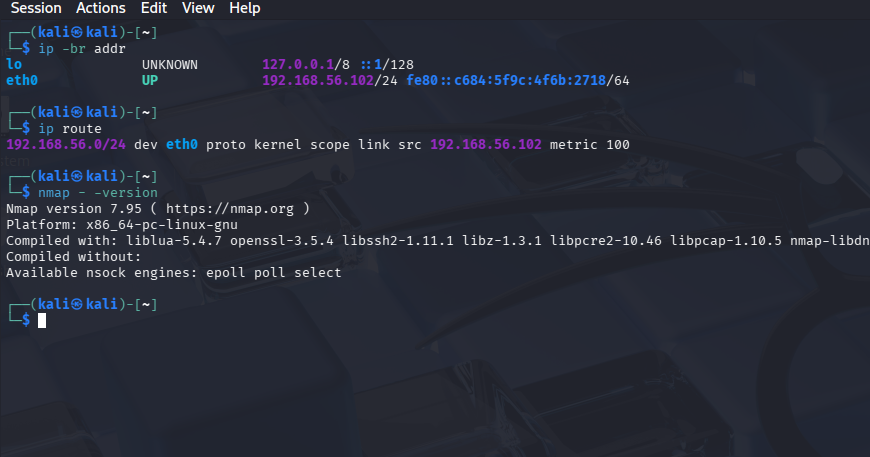
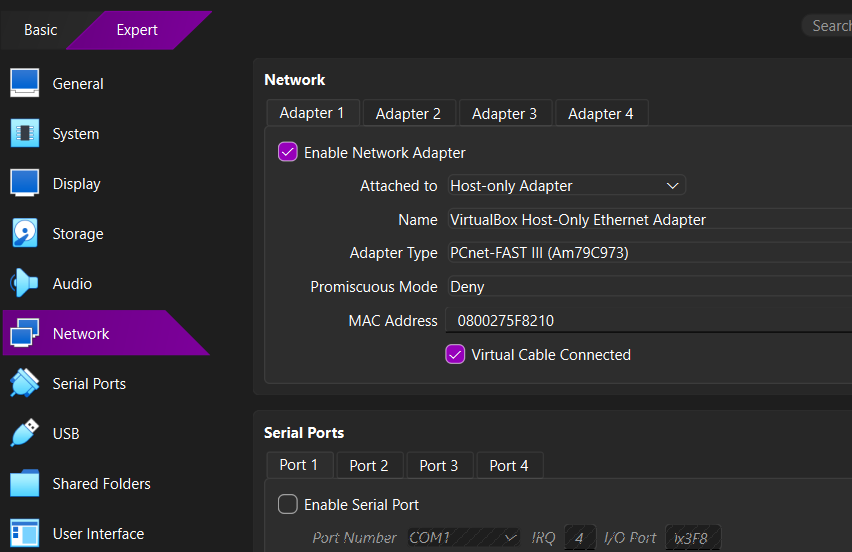
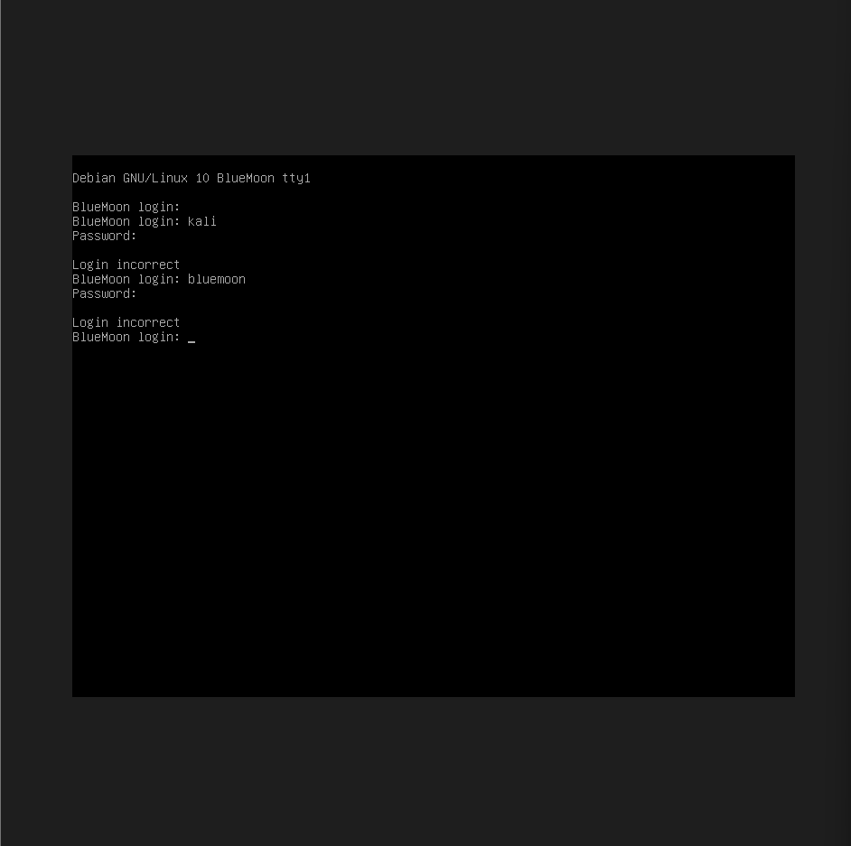
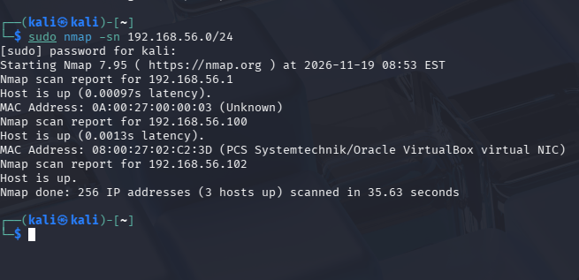
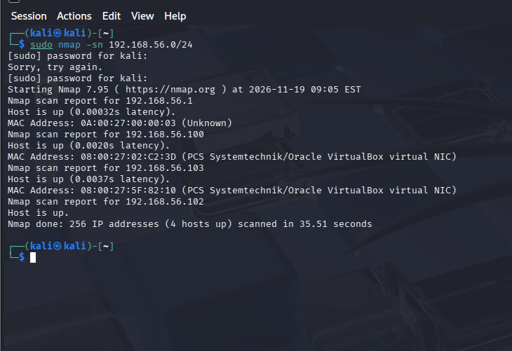
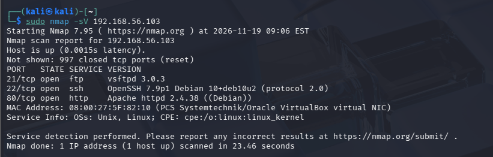
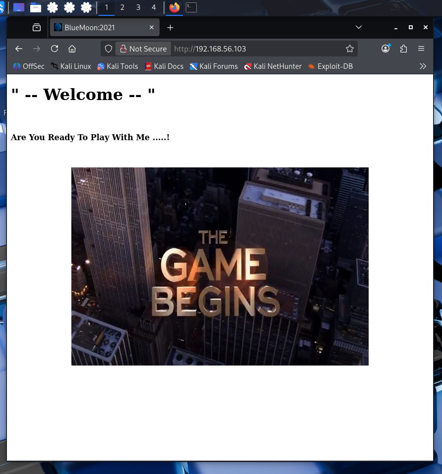
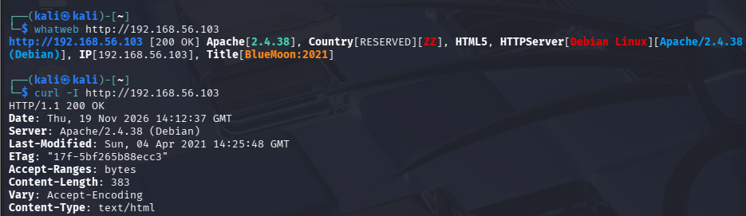

# BlueMoon:2021 — Active Footprinting (Week 5, Lab 4)

**Course topic:** Reconnaissance & Footprinting  
**Lab:** Active Footprinting (Vulnerable Machine)  
**Date of practical:** 19 November 2026  
**Environment:** Kali Linux and BlueMoon:2021 on an isolated VirtualBox host-only network

## Objective and scope

This exercise documents authorized active reconnaissance of a locally hosted, intentionally vulnerable BlueMoon virtual machine. The goal is to identify network hosts, enumerate exposed TCP services, examine the HTTP response, and explain what the observations establish and what remains uncertain. No exploitation, password attacks, or scans of public systems were performed as part of this documented exercise.

## 1. Lab setup

| Item | Observed configuration |
| --- | --- |
| Attacker VM | Kali Linux |
| Target VM | BlueMoon:2021 (Debian GNU/Linux 10 login screen) |
| Hypervisor | Oracle VirtualBox |
| Target adapter | Host-only Adapter, VirtualBox Host-Only Ethernet Adapter |
| Kali network interface | `eth0` |
| Kali IP/CIDR | `192.168.56.102/24` |
| Lab network | `192.168.56.0/24` |
| Target IP | `192.168.56.103` |
| Nmap version | 7.95 |

The Kali routing output showed a connected route for `192.168.56.0/24` on `eth0`. The screenshots do not show a default gateway, so none is claimed.

**Evidence:**







## 2. Host discovery

Command used:

```bash
sudo nmap -sn 192.168.56.0/24
```

Before BlueMoon was started, the discovery scan showed three responsive addresses: `192.168.56.1`, `192.168.56.100`, and `192.168.56.102`. After BlueMoon was started, a subsequent scan showed four responsive addresses, including the new `192.168.56.103` with MAC `08:00:27:5F:82:10`, matching the target's VirtualBox network configuration.

| Address | Interpretation |
| --- | --- |
| `192.168.56.1` | Likely host-side VirtualBox interface; not independently verified |
| `192.168.56.100` | Another responding VirtualBox-related address; exact role unverified |
| `192.168.56.102` | Kali Linux, confirmed from local interface output |
| `192.168.56.103` | BlueMoon target, confirmed by matching MAC and webpage |

**Evidence:**





## 3. TCP services and interpretation

Command used:

```bash
sudo nmap -sV 192.168.56.103
```

The service-detection scan reported that the target was up, with **three open TCP ports** among Nmap's 1,000 default TCP ports; the remaining **997 were reported closed**.

| Port | State | Identified service | Reported version | Interpretation |
| --- | --- | --- | --- | --- |
| `21/tcp` | Open | FTP | vsftpd 3.0.3 | File-transfer service reachable on the lab network |
| `22/tcp` | Open | SSH | OpenSSH 7.9p1 Debian 10+deb10u2 | Remote shell service reachable on the lab network |
| `80/tcp` | Open | HTTP | Apache httpd 2.4.38 (Debian) | Web service reachable on the lab network |

A service banner is an identification clue, not proof of a vulnerability or of missing security patches.



### Web service investigation

The BlueMoon homepage loaded in Kali Firefox at `http://192.168.56.103`, displaying the title **BlueMoon:2021**. The browser labeled the HTTP connection **Not Secure**.



Commands used:

```bash
whatweb http://192.168.56.103
curl -I http://192.168.56.103
```

WhatWeb returned `200 OK`, Apache `2.4.38`, HTML5, and the title `BlueMoon:2021`. The HTTP HEAD response also returned `HTTP/1.1 200 OK`, `Server: Apache/2.4.38 (Debian)`, and `Content-Type: text/html`. Its `Last-Modified` header was dated 4 April 2021; this reflects a resource timestamp, **not** the last security patch date.



## 4. Potential risks and defensive recommendations

| Observation | Potential risk / uncertainty | Suggested defensive control |
| --- | --- | --- |
| FTP exposed on port 21 | Plain FTP can transmit credentials and data without encryption if configured that way | Disable FTP if unnecessary, or use SFTP/FTPS |
| SSH exposed on port 22 | Weak authentication or overly broad network access could increase risk; not tested here | Restrict source IPs, prefer key-based authentication, patch SSH |
| HTTP on port 80 | This observed connection is unencrypted | Use HTTPS for sensitive web services |
| Apache version reported | Banner alone cannot establish patch status or exploitability | Verify installed package updates and vendor advisories |

These are **potential risks**, not verified exploitable weaknesses.

## 5. Limitations and confidence

- Host discovery can miss systems that block discovery probes or are offline.
- Nmap `-sV` used its default selection of 1,000 TCP ports, not all 65,535; UDP services were not assessed.
- Service/version detection may be incomplete or misleading if banners are customized or distributions backport security patches.
- Open ports do not demonstrate successful authentication, access, or exploitation.
- HTTP response headers and a successful page load establish reachability, not application security.
- Results are a point-in-time snapshot from 19 November 2026. The Kali VM displayed an EST timezone in its terminal output.
- No exploit, brute-force, credential collection, or destructive testing was performed.

**Confidence:** High for the observed IPs, reachable services, and HTTP responses shown in screenshots; limited for the underlying security posture and untested ports.

## Conclusion

The authorized host-only VM reconnaissance successfully identified BlueMoon at `192.168.56.103`, found FTP, SSH, and HTTP services, and confirmed that the HTTP homepage responds. The exercise demonstrates the difference between **evidence of exposure** and **proof of a vulnerability**. A fuller security assessment would require separately authorized, appropriately scoped validation.

## Repository structure

```text
BlueMoon-Active-Footprinting-Lab4/
├── README.md
└── screenshots/
    ├── 01-kali-network-and-nmap.png
    ├── 02-initial-host-discovery.png
    ├── 03-bluemoon-vm-settings.png
    ├── 04-bluemoon-login-screen.png
    ├── 05-bluemoon-host-discovery.png
    ├── 06-nmap-service-scan.png
    ├── 07-bluemoon-webpage.png
    └── 08-whatweb-http-headers.png
```

**Safety note:** All IPs shown are private lab addresses. Do not run these scans against third-party systems without explicit authorization.
